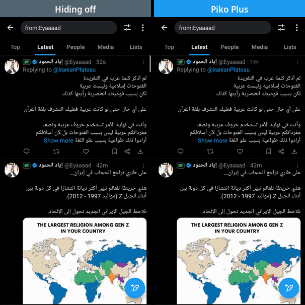
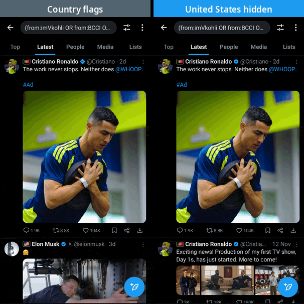
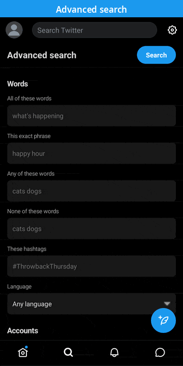
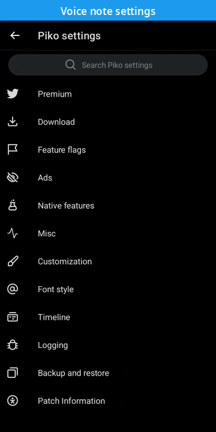

# بيكو بلس

**العربية** | [English](README.en.md)

تويتر بواجهته الأصلية، الطائر الأزرق والتصميم الكلاسيكي، مع مزايا لا يقدمها التطبيق الرسمي ولا بيكو الأصلي. هذا الفرع مبني على [بيكو](https://github.com/crimera/piko) (الإصدار 3.11.1) ومطبَّق على X بإصدار 12.19.1. واجهة التطبيق وإعداداته باللغة الإنجليزية، ولذلك تُذكر أسماء الإعدادات هنا كما تظهر في التطبيق.

**[تنزيل أحدث إصدار](../../releases/latest)**

## الإعلانات والشراكات المدفوعة

- تُخفى المنشورات المروَّجة، والشراكات المدفوعة (Paid partnership)، والمنشورات التي يصفها أصحابها بأنها إعلان بسطر مستقل (Ad أو Promoted أو «إعلان»)، وكذلك المنشورات التي تقتبسها.
- قائمة `Allow ads from` لاستثناء حسابات تريد أن ترى إعلاناتها.
- سجل `Recently hidden posts` بآخر ما أُخفي، لتعرف ما الذي حُجب ومن أي حساب.
- إخفاء غروك وعروض الاشتراك وزر الترويج واقتراحات المتابعة والسلاسل المباشرة (Live threads)، والمواضيع الرائجة و«منشورات لك» في صفحة الاستكشاف.

## الدول والأعلام

- علم دولة الحساب أو منطقته في إطار بجانب الاسم، ولا يقطعه الاسم الطويل.
- إخفاء منشورات الحسابات من الدول أو المناطق التي تحددها في `Blocked countries`، ومعها المنشورات التي تقتبسها والردود عليها، حتى ما كان ظاهرًا على الشاشة. القائمة الافتراضية: الهند، إسرائيل، اليمن، جنوب آسيا، غرب آسيا، أفريقيا.
- الحسابات التي لا تُعرف دولتها بعد تبقى ظاهرة ويُسأل عنها، فإذا عُرفت دولتها أُخفيت منشوراتها. والفكرة مأخوذة من [Control Panel for Twitter](https://github.com/insin/control-panel-for-twitter).

## البحث

- البحث يعمل من جديد في الواجهة الأصلية، بعد أن صار خادم X يشترط معاملًا لم يكن يرسله التطبيق القديم.
- البحث المتقدم الموجود في موقع X، نموذجًا أصليًا في صفحة البحث الفارغة: الكلمات والعبارات والحسابات والردود والروابط والتفاعل والتواريخ.

## الخط الزمني

- زر «غير مهتم» (Not interested) في شريط أزرار منشورات «لك»، يخبر X بأن المنشور لا يهمك ويخفيه، مع إمكانية التراجع.
- كتم اقتباسات منشور معيَّن، وإخفاء الردود على المنشورات المخفية، وإخفاء المحادثات التي يبدؤها شخص لا تتابعه كما كان تويتر سابقًا.
- عرض جميع وسائط المنشور (حتى 20 صورة أو مقطعًا) دفعة واحدة دون قص، في صفوف تناسب المنشور. وعلى الاتصال البطيء تُحمَّل بالترتيب، صورتين في كل مرة، مع مؤشر تحميل على كل صورة.

## المحادثات والرسائل الصوتية

- المحادثات (X Chat) تعمل من جديد: يُبلَّغ X Chat برقم إصدار أحدث يمكن تعديله من الإعدادات، فلا تظهر رسالة «Update Required».
- الرسائل الصوتية التي ترسلها تُحذف منها فترات الصمت عند انتهاء التسجيل، على الهاتف نفسه، كما في [clearcut](https://github.com/24bit192kHz/clearcut-web).
- زر المقص بجانب مدة أي رسالة صوتية يشغّلها دون صمت، ويعرض مدتها قبل الحذف وبعده (مثلًا 0:42 ← 0:31).
- إزالة ضوضاء الخلفية (المراوح والطرق والغرف) بنموذج [DeepFilterNet3](https://github.com/Rikorose/DeepFilterNet) على الهاتف، في نسخة arm64.
- سرعة تشغيل من 1× إلى 2× داخل الرسالة، وتسجيل منشور صوتي من شاشة الكتابة.

## مزايا أخرى

- رفع الصور والمقاطع بجودة عالية، وتعطيل كشف لقطات الشاشة في المحادثات، ورموز آبل التعبيرية افتراضيًا، واستيراد رمز الدخول من أي نوع ملف.
- بدء تشغيل أسرع وخط زمني أخف، وحجم أصغر: خط الرموز التعبيرية مضغوط دون فرق مرئي، وحُذفت مكتبات التحقق من الهوية غير المستخدمة.
- إصلاحات لمشكلات في بيكو الأصلي، أُرسلت إليه أيضًا: الترجمة الإجبارية مع إخفاء ملاحظات المجتمع، وحفظ الصور بصيغتها الأصلية، وتجاوز مقاطع الجودة العالية التي لا يستطيع الجهاز تشغيلها، ومصدر المنشور دون تجميد.

## التثبيت

| الملف | الجهاز |
|---|---|
| `X-12.19.1-piko-plus-arm64-v8a.apk` | معظم الهواتف الحديثة |
| `X-12.19.1-piko-plus-armeabi-v7a.apk` | الهواتف القديمة ذات 32 بت (دون إزالة الضوضاء) |
| `X-12.19.1-piko-plus-x86_64.apk` | المحاكيات وWaydroid وChromeOS (دون إزالة الضوضاء) |
| `X-12.19.1-piko-plus-universal.apk` | أي جهاز (الأكبر حجمًا) |
| `piko-plus-3.11.1.mpp` | حزمة التعديلات لمن يطبّقها بنفسه عبر [Morphe](https://morphe.software) على X 12.19.1 |

- كل الإصدارات موقَّعة بالمفتاح نفسه، فيُثبَّت الإصدار الجديد تحديثًا مع بقاء تسجيل الدخول.
- من ينتقل من تطبيق X الرسمي يحذفه أولًا، ويمكنه نقل تسجيل الدخول برمز الدخول من إعدادات بيكو.
- إذا حوّلك X إلى واجهته الجديدة فافتح الإعدادات، ثم **Original X** في أسفل الصفحة، ثم Switch Anyway.
- إعدادات بيكو كلها في: الإعدادات، ثم **Piko settings**، وفيها بحث يصل إلى أي خيار.

## شكر

- [crimera/piko](https://github.com/crimera/piko) ومساهموه، وعليه يقوم هذا الفرع كله. وتفاصيل بيكو الأصلي وقائمة تعديلاته في [الصفحة الإنجليزية](README.en.md#upstream-piko).
- [Control Panel for Twitter](https://github.com/insin/control-panel-for-twitter) لفكرة تصفية الدول والردود.
- [DeepFilterNet](https://github.com/Rikorose/DeepFilterNet) و[Silero VAD](https://github.com/snakers4/silero-vad) للرسائل الصوتية.

## الترخيص

[GNU General Public License v3](https://www.gnu.org/licenses/gpl.html) أو أحدث، مثل بيكو الأصلي.

